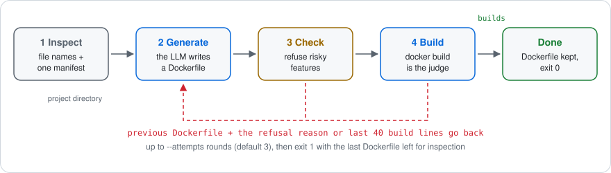

# dockergen

**Dockerfiles from a local LLM, judged by `docker build`. When a build fails, the error goes back to the model for the next attempt.**

[](https://github.com/OBOneProtocol/llmops-infra-guide/actions/workflows/tests.yml)


<p align="center">
  <picture>
    <source media="(prefers-color-scheme: dark)" srcset="assets/loop-dark.svg">
    
  </picture>
</p>

A successful build is the only thing that counts as success. Every Dockerfile
is printed before it is built, an existing `Dockerfile` is backed up first, and
`--dry-run` lets you review one without building anything.

## Quickstart

```bash
git clone https://github.com/OBOneProtocol/llmops-infra-guide.git
cd llmops-infra-guide
ollama pull qwen2.5-coder:7b          # needs Ollama and Docker running locally
python3 dockergen.py samples/flask-app --dry-run   # write and print, build nothing
python3 dockergen.py samples/flask-app             # generate, build, retry on failure
```

## Sample results

| Run | Model | Project | Outcome |
|---|---|---|---|
| Sep 2026 | `qwen2.5-coder:7b` | Node.js sample | The first build copied `node_modules` into the context. The build error went back to the model, and the retry produced a multi-stage build that ignores local modules ([FAILURES.md](FAILURES.md)). |
| Nov 2026 | `qwen2.5-coder:1.5b` | Go sample, `--network none` | Built on the first attempt (exit 0). The image did not start: it set `USER go`, which the Alpine base doesn't have (`docker run` exit 125). See Limits. |
| Nov 2026 | `qwen2.5-coder:1.5b` | Go sample, `--dry-run` | Wrote and printed a Dockerfile, built nothing (exit 0). |

The default `qwen2.5-coder:7b` has not been re-tested with the current version.

## How it works

1. **Inspect** the project: top-level files and the first dependency manifest found (`requirements.txt`, `pyproject.toml`, `package.json`, `go.mod`, `Cargo.toml`, `Gemfile`).
2. **Generate** a Dockerfile with fixed rules in the prompt: pinned base image, dependencies installed before the source is copied, non-root user where possible, explicit start command.
3. **Build** it with `docker build`.
4. **Correct**: on failure, the next prompt carries the previous Dockerfile and the last 40 lines of build output. Repeat up to `--attempts` times.

Each Dockerfile is printed before it is built. Before building, `check_dockerfile` refuses features that reach beyond a plain build (see Safety); a refused Dockerfile is not built, and the refusal reason goes back to the model as a failed attempt.

An existing `Dockerfile` in the project is backed up (`Dockerfile.bak-<timestamp>`, with `-1`, `-2`… added if that name is taken) before anything is written; backups are never overwritten and are left out of the prompt.

## Usage

```bash
ollama pull qwen2.5-coder:7b
python3 dockergen.py samples/flask-app
python3 dockergen.py path/to/app --model qwen2.5-coder:1.5b --attempts 5
python3 dockergen.py path/to/app --network none   # RUN steps get no network
python3 dockergen.py path/to/app --dry-run        # write and print one Dockerfile, build nothing
```

| Option | Default | Meaning |
|---|---|---|
| `--model` | `qwen2.5-coder:7b` | Ollama model name |
| `--url` | `http://localhost:11434/api/generate` | Ollama endpoint |
| `--attempts` | `3` | generate/build rounds before giving up |
| `--tag` | `dockergen-test` | image tag for test builds |
| `--network` | `default` | network for `RUN` steps during the build: `default` or `none` |
| `--dry-run` | off | write and print one Dockerfile, do not build it |
| `--llm-timeout`, `--build-timeout` | `300`, `900` s | per-call limits |

| Exit code | Meaning |
|---|---|
| `0` | a Dockerfile was written and built (with `--dry-run`: written and printed, not built) |
| `1` | every attempt failed to build or was refused by `check_dockerfile` (with `--dry-run`: the one Dockerfile would be refused); the last Dockerfile is left for inspection |
| `2` | usage or setup error: not a directory, `--attempts` below 1, Docker not on PATH or its daemon unreachable, Ollama unreachable or its reply malformed or empty, `Dockerfile` is a symlink |

## Safety

- **The model's `RUN` steps execute.** `docker build` runs every `RUN` line the model writes, on your machine, inside the build container. Use dockergen on projects you trust and read the Dockerfile it prints before each build.
- **`--network none`** gives `RUN` steps no network, so they cannot download or send anything. Base images are still pulled. Builds that install dependencies at build time (`pip install`, `npm install`, `go mod download` with real modules) will fail under it.
- **`--dry-run`** writes and prints one Dockerfile and builds nothing, so you can review it first.
- **Refused features.** A Dockerfile is not built if it uses a `# syntax=` directive (custom BuildKit frontend), `--mount=`, `--network=` or `--security=` flags, or `ADD` from an `http(s)://` URL.
- **Symlinks.** A `Dockerfile` that is a symlink stops the run (exit 2) and the file is written with `O_NOFOLLOW`. A dependency manifest that is a symlink or resolves outside the project is skipped, so it never reaches the prompt.
- **`COPY . .` copies everything** in the project directory, including files like `.env`, unless a `.dockerignore` excludes them. The image stays local, but check before you push it anywhere.
- **Remote `--url`.** The prompt (top-level file names, one dependency manifest, and on retries the previous Dockerfile and build output) goes to whatever `--url` points at. dockergen warns when the host is not `localhost`, `127.0.0.1` or `::1`.

No third-party Python packages are needed; the tool uses only the standard library.

## Samples

`samples/` holds three minimal "hello" services to try it on: Flask (`flask==3.0.3`), Express (`express 4.18.2`) and Go's `net/http` (Go 1.21).

## Tests

```bash
python3 -m pytest -q tests
```

The tests run offline: the model and `docker build` are replaced by fakes, so they check the loop itself (retry prompt contents, error truncation, backups that never overwrite, exit codes 0/1/2 from `main()`), reply parsing (fence variants, empty and malformed Ollama replies), the safety checks (each refused pattern, refused Dockerfiles never built, symlinks, `--dry-run`, the remote `--url` warning) and the sample manifests. CI runs them on every push with read-only permissions and SHA-pinned actions.

## Limits

- One project directory at a time; monorepos need a path per service.
- Success means the image built; dockergen never runs the image. Build-time `RUN` steps do execute (see Safety), but the app's start command is never tried, so a build that succeeds can still produce an image that does not start.
- The prompt sees file names and one manifest, not the source code.
